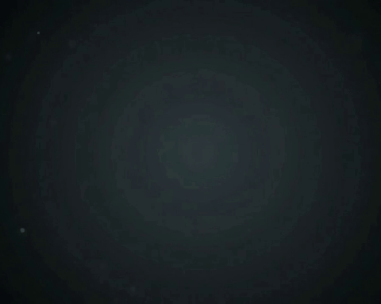

# 🐉 Augmented Reality Dragon Tracker (Unity + AR Foundation)

An interactive **Augmented Reality (AR)** project built using **Unity** and **AR Foundation**, where scanning a real-world image spawns a **3D Dragon** that can be controlled using an on-screen **joystick** and unleash a **fire attack**! Perfect for beginners exploring AR development and mobile-based interaction 🚀

[📺 Demo Video (Made with Unity)](intro.mp4)



---

## ✨ Features

- 📸 **AR Image Tracking** — Scan a real-world image to trigger AR content
- 🐲 **3D Dragon Model** — A stylized 3D dragon spawns over the image
- 🎮 **Joystick Control** — Use a virtual joystick to control dragon movement in real time
- 🔥 **Fire Breath Attack** — Unleash a devastating Hellfire particle breath stream with roar audio & damage
- 📱 **Android Support** — Deploys and runs smoothly on Android devices
- ⚡ **Lightweight Build** — Optimized for mobile devices using Unity LTS

---

## 🔧 Tech Stack

| Tool            | Description                                 |
|-----------------|---------------------------------------------|
| Unity (2021.3.6 LTS) | Core development engine                    |
| AR Foundation   | Image tracking and AR scene management      |
| ARCore          | Backend engine for Android AR               |
| C#              | Custom scripts for dragon control, movement & fire attack |
| Fixed Joystick (Joystick Pack) | Virtual joystick for user input             |
| Game Assets     | 3D Dragon model + Target reference image    |

---

## 📁 Project Structure

```

AR-Dragon-Tracker/
├── Assets/
│   ├── Dragon/
│   │   └── dragon.glb         # 3D Dragon model
│   ├── Scripts/
│   │   ├── PrefabCreator.cs   # Spawns dragon on image detection
│   │   ├── DragonController.cs # Handles joystick-based movement & physics
│   │   ├── DragonFireAttack.cs # Fire breath particle attack, roar SFX & damage
│   │   └── FixedJoystick.cs   # Virtual joystick touch/drag controller
│   └── ImageLibrary/
│       └── GameOfThrones.jpg  # Tracked reference image
├── intro.mp4                  # Made with Unity cinematic video
└── demo.gif                   # Animated demonstration preview

```

---

## 🕹️ Interaction Flow

1. 🖼️ **Scan Image** → The app detects a reference image (e.g., `GameOfThrones.jpg`).
2. 🐉 **Dragon Spawns** → The dragon model appears above the image in Augmented Reality.
3. 🎛️ **Use Joystick** → Move the dragon around smoothly using the on-screen virtual joystick.
4. 📐 **Physics & Rotation** → The dragon moves naturally and rotates toward the direction of movement.
5. 🔥 **Fire Attack** → Press the Fire button to trigger flame breath particles, roar SFX, and deal damage!

---

## 🧠 How It Works

### 🔍 AR Image Tracking
- Unity’s `AR Tracked Image Manager` listens for image detection.
- When the target image is found, it triggers the `PrefabCreator.cs` script.
- The dragon prefab is instantiated with a slight vertical offset.

### 🐉 Dragon Control Logic
- `DragonController.cs` script reads input from `FixedJoystick.cs`.
- Movement is handled via Unity physics using `Rigidbody`.
- Rotation ensures the dragon faces the direction it’s moving.

### 🔥 Fire Attack System
- `DragonFireAttack.cs` controls the mouth particle emitter (`ParticleSystem`).
- Plays roaring audio clips and creates an area-of-effect damage sphere.

### 🛠️ Android Configurations
- ✔️ Switched platform to Android in Build Settings
- ✔️ Enabled ARCore in XR Plugin Management
- ✔️ Set API Level ≥ 24
- ✔️ IL2CPP & ARM64 architecture for performance

---

## 🎯 Use Case

This project is great for:

- 🎓 Learning basic AR development using Unity
- 🧪 Experimenting with mobile AR & 3D object control
- 🛍️ Retail, gaming, or promotional AR experiences

---

## 📦 How to Run

1. Open project in Unity 2021.3.6 LTS or later.
2. Target reference image is located in `Assets/ImageLibrary/GameOfThrones.jpg`.
3. 3D Dragon model is located in `Assets/Dragon/dragon.glb`.
4. Connect Android device with USB debugging enabled.
5. Switch build platform to Android → Build & Run.

---

## 📚 Credits & Resources

- 🎥 Tutorial Source: [YouTube - Augmented Reality Game](https://www.youtube.com/watch?v=GfS72wqKQ_g)
- 🐉 Dragon 3D Model: Unity Asset Store
- Photo : Unsplash.com (https://unsplash.com/photos/brown-dragon-decor-JvKMMV6fLTA)
- 🎮 Joystick Pack: Unity Asset Store

---

## 🔮 Future Improvements

- ✨ Add wing flapping animation to the dragon
- 🔊 Add environmental ambient audio
- 🌍 Expand to plane detection markerless tracking
- 📲 Add iOS support via ARKit
